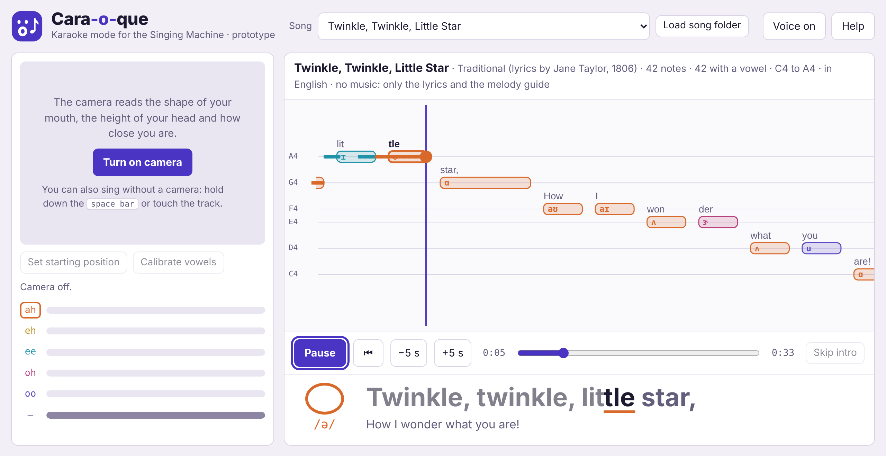

# Cara-o-que


A karaoke you sing with your face, made for people who have lost their voice after a laryngectomy.
The webcam reads the shape of your mouth (vowel), the height of your head (note) and how close you are (volume), and a synthetic singing voice sings along with the song.

<br clear="left">



**Try it online: https://cara-o-que.netlify.app/** (Chrome or Edge, with a webcam, or with the space bar if you don't have one).

Cara-o-que is part of **Archivoz**, a research project on a voice map of Argentine regional accents and on speech synthesis for laryngectomized people. It is a working prototype: it is meant to be tried with real users and improved from there.

## Features

- **Face control** with [MediaPipe Face Landmarker](https://ai.google.dev/edge/mediapipe/solutions/vision/face_landmarker): mouth shape → vowel, head height → note, distance → volume. A short calibration adapts it to each person's mouth.
- **Parametric singing voice** based on Cantor Digitalis, running in an `AudioWorklet`, with Spanish consonants (synthetic, plus recorded fragments of Rioplatense speakers from OpenSLR 61).
- **UltraStar songs**: any folder with an UltraStar `.txt` (and optionally its karaoke track) becomes a song.
- **Four assistance levels**, from «open your mouth on time» to free singing, with optional scoring.
- **No camera needed** to try it: the space bar, the `A E I O U` keys or touching the note lane work as a switch.
- **Spanish and English interface**, and experimental support for English songs (CMU Pronouncing Dictionary + Hillenbrand vowels).
- Everything runs in the browser. The camera image never leaves the computer.

## Getting started

You need [Node.js](https://nodejs.org/) (any version works to open the karaoke; the tests need Node 18 or newer) and Chrome or Edge.

**Windows:** double-click `Open karaoke.bat`. It starts a small local server and opens the karaoke at `http://127.0.0.1:8080/`. The black window that stays open is the server; closing it stops the karaoke.

**macOS / Linux:**

```bash
npm start          # same as: node tools/server.cjs --open
```

Then press «Turn on camera», sit comfortably (the starting position is set automatically) and press «Start». «Calibrate vowels» takes six short steps and makes vowel detection much more reliable.

The page has to be served over http because browsers do not load JavaScript modules or the `AudioWorklet` from `file://`. The server has no dependencies, only listens on `127.0.0.1`, and if port 8080 is taken (or reserved by Windows) it tries other ports, always in the same order.

The first time, the browser downloads MediaPipe and the face model (about 4 MB). To work offline, download `face_landmarker.task`, put it next to `index.html` and point `MODEL_URL` in `js/config.js` to it.

## How to sing

- **Camera:** open your mouth to make the voice sound; its shape picks the vowel; raise or lower your head to change the note; move closer to sing louder.
- **Switch:** hold the space bar or touch the lane to sing the expected vowel; `A E I O U` sing that vowel. An adapted switch that emulates the space bar works too.
- **Player:** `P` play/pause, `←` `→` 5 s back/forward, `Home` back to the start, «Skip intro». `V` mutes the voice without turning off the camera.
- **Level** sets how much help you get (pitch assist, vowel tolerance, how consonants are triggered), and **Practice / Continuous** whether the song waits for you to sing each syllable. The score is at the top right of the note track, with a switch to hide it. Everything else is under «Show advanced settings».

## Songs

Each song is a subfolder of `songs/` with an UltraStar `.txt` and, optionally, its music:

```
songs/
  Los pollitos dicen/
    los-pollitos-dicen.txt            ← lyrics and notes (UltraStar)
  My song/
    my-song.txt
    my-song (karaoke).mp3             ← optional backing track
```

The local server rebuilds the list every time the page loads, so a new folder shows up after a reload. You can also pick a folder by hand with «Load song folder», and the web version can read its songs from a shared Google Drive folder ([docs/google-drive.md](docs/google-drive.md)).

This repository only includes public-domain songs: «Los pollitos dicen», «Twinkle, Twinkle, Little Star» and the Argentine National Anthem. Any other song you copy into `songs/`, and every audio file, is ignored by git and stays on your computer (see [`songs/README.md`](songs/README.md)). To write new songs, the UltraStar Play editor, the MuseScore plugin or UltraSinger are good options.

## Project structure

There is no build step: the browser loads the ES modules directly.

```
index.html              the page
css/                    styles (light and dark theme)
data/                   recorded consonants (OpenSLR 61, CC BY-SA 4.0)
js/
  main.js               startup
  config.js, state.js   settings and shared state (S)
  logic/                pure logic, no DOM: UltraStar, vowels, pitch and score, articulation, English
  voice/                voice engine (AudioWorklet) and Web Audio setup
  camera/               MediaPipe face features and calibration
  songs/                song list, current song, demo songs, English dictionary
  playback/             main loop, consonant timing, player
  i18n/                 Spanish / English texts
  ui/                   drawing, controls, welcome dialog
songs/                  one folder per song
tools/                  local server, web and Netlify builds, offline renderer, dataset measurements
tests/                  tests for the logic and the voice engine
docs/                   technical notes
```

`js/logic/` does not import anything from the interface, so it can be tested in Node. Every file starts with a short comment that says what it does.

## Development

```bash
npm test                                         # logic and voice engine tests
node tools/render.mjs song "songs/Los pollitos dicen/los-pollitos-dicen.txt" audio/pollitos.wav
node tools/render.mjs catalog audio/consonant-catalog.wav
```

`tools/render.mjs` renders songs to WAV without a browser, using the same engine and consonant rules as the app; it is handy to listen to a change before trying it with the camera. Edit a file and reload the page: the local server does not cache anything.

The online version at https://cara-o-que.netlify.app/ is this same repository published on Netlify: every push to `main` updates it, and it reads the songs from a shared Google Drive folder, so adding a song doesn't need a new deploy. How I set up the Drive folder is in [docs/google-drive.md](docs/google-drive.md). If you'd rather not use Netlify, `Build web version.bat` makes a `web-version/` folder with the local songs that you can upload to any site with https ([docs/publishing.md](docs/publishing.md)).

## Documentation

- [Voice engine and consonants](docs/voice-engine.md)
- [English songs](docs/english-songs.md)
- [Consonant measurements on OpenSLR 61](docs/openslr-measurements.md) and [how to repeat them](tools/measure-dataset/README.md)
- [Design decisions](docs/design.md)
- [Publishing the web version](docs/publishing.md) and [songs from Google Drive](docs/google-drive.md)

## Known limitations

- The default vowel templates are approximate; people with reduced lip movement should calibrate.
- Consonants are rule-based synthesis: understandable in context, but they do not sound like a recorded voice.
- The articulation gesture only uses mouth opening; it cannot tell a lip closure (/p/) from a jaw closure (/t/).
- Latency has not been measured yet («Compensate camera delay» adjusts it by hand).
- English support has not been tested with native speakers yet.

## Credits

- Voice model: L. Feugère, C. d'Alessandro, B. Doval and O. Perrotin, «Cantor Digitalis: chironomic parametric synthesis of singing», *EURASIP Journal on Audio, Speech, and Music Processing* 2017:2. Consonants inspired by Digitartic (same group, LIMSI).
- The voice engine adapts the Web Audio implementation by [Edward Browncross](https://github.com/edwardbrowncross/cantor-digitalis) (ISC license).
- Recorded consonants and measurements: OpenSLR 61, A. Guevara-Rukoz et al., «Crowdsourced Latin American Spanish for Low-Resource Text-to-Speech», *Proc. LREC 2020* (CC BY-SA 4.0).
- English: CMU Pronouncing Dictionary (Carnegie Mellon University) and J. Hillenbrand et al., «Acoustic characteristics of American English vowels», *JASA* 97(5), 1995.
- Soprano vowels: Barrientos Sandoval and Cataldo Ferreira, *IEEE Latin America Transactions* 19(12), 2021.

## License

The code is released under the [MIT License](LICENSE). The recorded consonant fragments in `data/` keep their original CC BY-SA 4.0 license, and third-party code and data are listed in [THIRD_PARTY_NOTICES.md](THIRD_PARTY_NOTICES.md).
